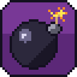

# WarioBlast Recomp: an unofficial static recompilation of Wario Blast Featuring Bomberman! (Game Boy, 1994)

> **Unofficial fan project.** Not affiliated with, endorsed by or sponsored by
> Nintendo, Hudson Soft or Konami. Wario, Game Boy and Super Game Boy are
> trademarks of Nintendo; Bomberman is a trademark of Konami. This repository
> contains **no** Nintendo or Hudson code or data. You need your own copy of
> the game (and, optionally, of the Super Game Boy). See [Legal](#legal).

This project translates the Game Boy ROM's SM83 machine code into C and runs
it natively on a small runtime (PPU, APU, timer, MBC1, Super Game Boy with
multiplayer) on SDL2, for Linux and Windows.

The recompiler, runtime, launcher, mod and cheat support come from the
sister project DK94 Recomp (Donkey Kong, 1994). What is specific to this game
is in [tools/recomp/overrides.toml](tools/recomp/overrides.toml) and
[tools/recomp/coverage.txt](tools/recomp/coverage.txt).

The ROM is **not** included. You need
`Wario Blast Featuring Bomberman! (USA, Europe) (SGB Enhanced).gb`
(CRC32 `927B57A1`, SHA-1 `279fb0223e362db553b739b1b8f9c18b81d92413`).

There are two builds:

* **Player** (what the releases contain): contains no game code. When you
  press PLAY it recompiles *your* ROM to C and compiles that in memory with
  [TinyCC](https://bellard.org/tcc/) (about 0.1 s), so nothing derived
  from the game is ever distributed or written to disk.
* **Developer build**: recompiles the ROM at build time and links the code
  in. Handy for development. The result contains game code, so it must
  not be shared.

Both run the same recompiler and produce identical results (verified with
the state-hash test below).

### Launcher

Run `warioblast` (or double-click `warioblast.exe`) with no arguments to
open the launcher:

* **Files.** It finds the ROM and SGB BIOS next to the executable or in the
  current directory, and checks them. The ROM is checked by its CRC32
  against the ROM this build was recompiled from. The BIOS is checked by
  locating the SGB sound driver inside it. Each file shows **OK**,
  **WRONG ROM** / **INVALID**, **MISSING** or **NOT SET**. PLAY is enabled
  only with the correct ROM; the BIOS is optional. Set files with
  **Browse…** (the standard file dialog on Windows, a built-in browser
  elsewhere) or by dropping them onto the window.
* **Options.** Hardware (Super Game Boy / Game Boy), display view, window
  scale, fullscreen, controller A/B layout, CPU core (recompiled /
  interpreter) and speed (normal / uncapped). The help line at the bottom
  explains the focused option.
* Works with mouse (click; right-click or wheel changes values backwards),
  keyboard (arrows, Enter, Esc, Delete clears the BIOS) or controller
  (D-pad, A, Start = Play).
* Settings, including the file paths, are remembered in the per-user config
  folder (`launcher.ini` in SDL's pref path: `%APPDATA%\WarioBlast\WarioBlast-Recomp`
  on Windows, `~/.local/share/WarioBlast/WarioBlast-Recomp` on Linux).

Passing any command-line option skips the launcher (add `--launcher` to
show it anyway).

### Multiplayer (Super Game Boy)

On a Super Game Boy, Battle mode supports up to 4 players through the SGB's
multiplayer adapter support (`MLT_REQ`). Each controller is one player: the
first controller (together with the keyboard) is player 1, the second is
player 2, and so on. While the game isn't in multiplayer mode (menus,
Normal mode), every controller drives player 1. Plain Game Boy mode
(`--dmg`) has no multiplayer, as on hardware without a link cable.

### Mods

Mod packs can replace graphics with HD versions (tiles, sprites,
backgrounds, the SGB border) and replace music and sound effects. Several
packs can be active at once. Manage them in the launcher under
**MOD PACKS**; F9 toggles them in game. A dump tool extracts the game's
tiles, border and audio requests to start from. See [MODDING.md](MODDING.md).

An example pack, [examples/mods/WarioBlast-Example](examples/mods/WarioBlast-Example)
(included in the releases), adds an HD border, HD status-bar digits and a
new first-stage tune. All of it is original work, generated by
[tools/make_example_pack.py](tools/make_example_pack.py).

### Cheats

GameShark and Game Genie codes, managed in the launcher under **CHEATS**
(type codes in with ADD CODE..., turn them on and off) or given with
`--cheat CODE`; **F8** toggles them in game. Built in: *never lose a bout*
(`008-DDB-EAE`) and *freeze stage timer* (`00F-ECE-EAE`). The list is kept in
`cheats.txt` next to the launcher settings (`on|off NAME = CODES`, one per
line; several codes with spaces or `+`).

* **GameShark** `01VVLLHH` writes value `VV` to RAM address `HHLL` every
  frame.
* **Game Genie** `ABC-DEF` or `ABC-DEF-GHI` replaces a ROM byte (with the
  compare byte only where the original matches). Recompiled code has the
  ROM's instructions built in, so the functions containing a patched byte
  run on the interpreter instead, which reads the patched ROM. The result
  is checked against the interpreter-only mode (identical state hashes).

Normal mode is a series of best-of-three matches, so instead of lives the
built-in cheat turns a lost bout into a draw (`01:48DC` records the result
in `$C590`: 0 draw, 1 lost, 2 won), and the bout is replayed. The timer
cheat zeroes the amount the timer routine at `$1FD6` subtracts every
2 seconds.

### Stage select

**START STAGE** in the launcher (or `--stage W-S`) starts new Normal games
at any of the 32 rounds, from 1-1 to 8-4 (stage 4 of each world is the
boss). Page Up / Down moves a world at a time. Passwords (title screen →
PASSWORD) work as usual.

The round is `$C3F0` (0–31). Every new game passes through the title's
initialisation at `0A:4013`, which clears it. The stage select rewrites
those bytes to load the chosen round instead, so it applies from the next
title screen on, and a password entered after that still takes precedence.

### Super Game Boy sound (optional)

On a Super Game Boy, this game also plays sounds on the SNES side. That
needs the SGB's SNES sound driver and instrument samples, which live in the
Super Game Boy BIOS (the SNES cartridge ROM, e.g. `Super Game Boy (World).sfc`).
Supply your own dump with `--sgb-bios FILE`, or put it next to the
executable or in the current directory under one of these names:
`Super Game Boy (World).sfc`, `... (Rev 1).sfc`, `... (Rev 2).sfc`,
`Super Game Boy (Japan, USA).sfc`, `sgb.sfc`. Without it everything else
works and those SNES-side sounds are silent.

## Build

Requirements: CMake ≥ 3.16, Ninja (or make), a C11 compiler, Python ≥ 3.11
(build-time table generation only), SDL2. x86-64 only.

### Player (distributable)

```sh
cmake -S . -B build-player -G Ninja -DWB_PLAYER=ON
ninja -C build-player      # downloads TinyCC 0.9.27 (SHA-256 checked) unless -DTINYCC_DIR=...
./build-player/warioblast
```

Windows, cross-compiled from Linux/WSL with MinGW-w64:

```sh
# Arch: sudo pacman -S mingw-w64-gcc
# SDL2 dev package: SDL2-devel-2.32.10-mingw.tar.gz from github.com/libsdl-org/SDL/releases
cmake -S . -B build-win -G Ninja -DWB_PLAYER=ON -DCMAKE_TOOLCHAIN_FILE=cmake/mingw-w64.cmake \
      -DSDL2_DIR=$PWD/third_party/sdl2-mingw/SDL2-2.32.10/x86_64-w64-mingw32/lib/cmake/SDL2
ninja -C build-win
```

`tools/make_release.sh VERSION` builds both players and packages them, with
the license notices, into `dist/` (see [Releases](#releases)).

### Developer build (contains game code - do not distribute)

```sh
cmake -S . -B build -G Ninja      # needs the ROM in the source directory (or -DWB_ROM=...)
ninja -C build
./build/warioblast
```

## Controls

| Game Boy | Keyboard | Controller |
|---|---|---|
| D-pad | Arrow keys | D-pad or left stick |
| A | X or K | A / Y (B / X with `--swap-ab`) |
| B | Z or J | B / X (A / Y with `--swap-ab`) |
| Start | Enter | Start |
| Select | Right Shift / Backspace | Back / View |

| Function | Keyboard | Controller |
|---|---|---|
| Fast-forward (hold) | Tab | RB or RT |
| Cycle display view | F10 | LB |
| Fullscreen | F11 | Guide |
| Cheats on / off | F8 | – |
| Mods on / off | F9 | – |
| Quit | Esc | – |

Any number of controllers can be used at once and plugged in or out while
the game runs (see [Multiplayer](#multiplayer-super-game-boy) for how they
map to players). Controllers SDL doesn't recognise can be added with a
`gamecontrollerdb.txt` (SDL format, e.g. from the community
SDL_GameControllerDB project) placed next to the executable.
`--swap-ab` puts A/B in Nintendo positions (A on the right). Under WSL,
controllers are not visible to Linux programs (no `/dev/input`); use the
Windows build there. `WB_PAD_SELFTEST=1 warioblast` checks the controller
code with virtual controllers.

The cartridge has no battery RAM, so there is no `.sav` file.

### Widescreen

Nothing is ever stretched; the game's pixels stay square and unscaled.
Choose a view in the launcher, with `--view`, or cycle with **F10** / **LB**:

| view | what you get |
|---|---|
| `original` (default) | the native image: 256×224 with the SGB border, or 160×144 |
| `frame` | 16:9 canvas (400×224 SGB, 256×144 DMG): the native image centred, with the sides filled by a blurred, darkened extension of it |
| `wide` **(experimental)** | true widescreen 256×144: the playfield rendered 48 px further on each side, using the game's own tilemap and sprites |

**`wide` is experimental.** During a match (Normal or Battle) it shows the
whole arena across the full width. The arena is up to 17 × 17 cells of
16 px (272 px), and the game keeps all of it in the 256-px tilemap: the
right and bottom walls wrap onto the left and top ones. So the wide view
draws arena pixels 0–271 through the tilemap and leaves everything beyond
the walls empty. The status bar continues across the width. A sprite left
of the original view whose 8-bit X coordinate wrapped is put back on the
left. These notes are in the `[wide]` section of `overrides.toml`; a match
is recognised by the status bar's window position (WY 136, WX 7).

On other screens (menus, intros, scoreboards) it shows only tilemap data
the game drew for the current screen, and falls back to the `frame`-style
blur where there is nothing more to see.
All views are render-only: the emulation is identical in every view.

Options: `--stage W-S`, `--cheat CODE`, `--mod NAME`, `--mods-dir DIR`, `--no-mods`, `--dump DIR`, `--dump-audio`, `--launcher`, `--fullscreen`, `--dmg` (plain Game Boy, no SGB border/colours), `--scale N`, `--view MODE` (`wide` is experimental), `--swap-ab`,
`--interp`, `--headless`, `--unthrottled`, `--frames N`, `--no-save`,
`--sgb-bios FILE`, `--input random:SEED`, `--hash-log FILE`, `--log-fallback FILE`,
`--screenshot FILE`, `--wav FILE`. See `warioblast --help`.

## How it works

```
runtime/recomp/ the recompiler (C): recomp.c = bank-aware control-flow
                discovery + C generation, used at runtime by the player and
                at build time by tools/recomp/wb_recomp.c
runtime/        runtime: cpu.c (dispatcher + interpreter), mem.c (memory map,
                MBC1, IO, timer, joypad), ppu.c, apu.c, sgb.c, platform_sdl.c,
                main.c, native.c (player: compile with TinyCC), launcher.c, pad.c
                SGB sound: sgb_sound.c (SNES-side BIOS logic), spc.c (SPC700), dsp.c (S-DSP)
assets/icon/     the project icon (original pixel art), generated by tools/make_icon.py
tools/recomp/
  sm83.py         opcode table: every instruction's semantics as a C template
  gen_tables.py   build-time generator: opcode table, interpreter, game notes,
                  TinyCC prelude (none of it from the ROM)
  overrides.toml  game notes: jump-table / bank-switch / far-call routines,
                  sound-driver RAM addresses, expected ROM CRC32
  coverage.txt    ROM addresses seen executing at runtime (extra entry points)
  wb_recomp.c     ahead-of-time recompiler CLI for the developer build
```

* **Analysis.** Starting from the reset and interrupt vectors, the analyzer
  follows jumps and calls, tracking the ROM bank selected by
  `ld a,N / call $0AA3` (or a direct write to the MBC). It understands
  Wario Blast's dispatch idioms: `rst 10h` / `call $0760` inline jump
  tables; the far call `ld hl,ADDR / ld b,BANK / call $0A90`; the
  `ld bc,ADDR / rst 08h` "continue here after the frame wait" of the main
  loop; `ld hl,TABLE … jp hl` local tables; and pushed return addresses.
  Addresses from `coverage.txt` are added as further entry points.
* **Code generation.** Each entry point becomes a C function keyed by
  `(bank, address)`. Every instruction is a label and a resume point, so the
  dispatcher can re-enter a function after a `ret`, an interrupt or a bank
  switch. Code in the switchable bank checks the mapped bank before each
  instruction.
* **Compilation.** The developer build compiles the generated C with the
  system compiler. The player compiles it at startup with TinyCC (shipped
  as `libtcc.dll` / `libtcc.so`). The compiled code makes no external
  references. It reaches the runtime through pointers bound after loading,
  and a struct-layout probe checks that both compilers agree before running it.
* **Execution.** The dispatcher looks up `(mapped bank, pc)` and runs the
  recompiled function. If there is none, it runs the fallback interpreter
  instead: for code in RAM (such as the OAM-DMA routine in HRAM) or ROM
  code the analysis missed. The interpreter is generated from the same
  opcode table, so it has identical semantics.
* **Timing.** Every instruction advances the PPU, timer and APU by its exact
  cycle count, and interrupts are checked before every instruction, in both
  the recompiled code and the interpreter.
* **Sound driver.** The game's driver lives in bank 7. Songs are requested
  through `$D900`, effects through `$D901`, and `$D90C` holds the channels
  an effect is using. Mods hook these addresses to replace audio. This is
  output-only; the emulation is unchanged.

## Verification

```sh
python3 tools/verify.py compare            # recompiled vs interpreter, per-frame state hashes
python3 tools/verify.py fallback           # how much ROM code still runs on the interpreter
python3 tools/verify.py coverage           # grow coverage.txt with random-input runs, then rebuild
```

`compare` runs each seed twice with deterministic pseudo-random input, once
with `--interp` and once with the recompiled code, and requires identical
hashes of the screen, WRAM, HRAM, registers and cycle count on every frame.
Current status: identical on 16 seeds × 20,000 frames. The player build
and the Windows build produce the same hashes as the developer build. On
unseen seeds no ROM code falls back to the interpreter.

Random input mostly plays the title screen, menus and the first stages of
Normal and Battle mode. To recompile code reached only later in the game,
play a reference build with `--interp --log-fallback more.txt`, append the
file to `tools/recomp/coverage.txt`, and rebuild. Code that is still
missing works anyway, via the interpreter.

Debugging aids (environment variables): `WB_TRACE=file` /
`WB_TRACE_FROM=frame` (instruction, memory-write and WRAM/HRAM-read trace),
`WB_POKE="frame:addr=val,...;..."`, `WB_HOLD="from-to:buttons[@player];..."`,
`WB_DUMP_VRAM=file`, `WB_WIDE_NOMASK=1`, `WB_SGB_LOG=1`, `WB_SPC_LOG=1`,
`WB_DEBUG=1`, `WB_LAUNCHER_CONFIG=file`, `WB_LAUNCHER_KEYS=down,right,enter,...`,
`WB_LAUNCHER_SHOT=file`, `WB_RAMLOG=C000-C0FF`, `WB_SGB_SOUND="frame:a,b,attr,score"`,
`WB_PROFILE=1`. The current round is at WRAM `$C3F0`.

## Legal

* **What's here.** Only original source code (recompiler, runtime, tools)
  and notes about the game: addresses, routine descriptions and a list of
  executed code addresses (`tools/recomp/coverage.txt`). No ROM, BIOS,
  graphics, music, generated code or binaries.
* **What you supply.** The game ROM and the optional Super Game Boy BIOS
  must be dumped from hardware you own. This project does not link to or
  provide them.
* **Only distribute the player.** A *developer* build contains the game's
  code translated to C, i.e. copyrighted code in another form: never share
  it, or `build*/gen/`. The *player* build contains no game code; it
  recompiles the user's own ROM on their machine, in memory.
  `tools/make_release.sh` checks the packages for ROM data before release.
* **Clean implementation.** The S-DSP and SPC700 emulation were written from
  public hardware documentation (fullsnes, anomie's notes). Hardware
  constants such as the envelope rate table are facts about the chip.
* **License.** The source code is MIT-licensed (see `LICENSE`). The license
  covers only the source in this repository, not the game ROM, the Super
  Game Boy BIOS or any code generated from them. SDL2 is zlib-licensed.
  TinyCC is LGPL-2.1; the player uses it as a separate, unmodified shared
  library, and releases include its license and source. The vendored stb
  libraries (`runtime/third_party/`, image and Ogg Vorbis decoding) are
  public domain / MIT.
* **Mods.** The only mod content shipped is the example pack, which is
  original work (drawn and composed by `tools/make_example_pack.py`). Its
  tile file names are the 16-byte keys that identify the replaced tiles
  (MODDING.md). The dump tool writes the
  game's own graphics and sound from the user's ROM for local use; packs
  that are shared should contain original work only (see MODDING.md).

## Releases

`tools/make_release.sh VERSION` produces
`dist/WarioBlast-Recomp-VERSION-windows-x64.zip` and
`dist/WarioBlast-Recomp-VERSION-linux-x86_64.tar.gz`. Each contains the player,
`libtcc`, the license texts, a short readme, and TinyCC's source (LGPL).
The Windows package also has `SDL2.dll`. Linux needs SDL2 from the
distribution (e.g. `libsdl2-2.0-0`) and glibc 2.34 or newer.

## Limitations

* SGB sound needs a user-supplied SGB BIOS. The DSP uses a fitted Gaussian
  interpolation curve rather than the hardware's exact table, and is
  sample-accurate rather than cycle-accurate. `DATA_SND` code that a game
  injects into the SNES is not run.
* The PPU is scanline-based; mid-scanline register changes are not modelled.
* The HALT bug and the exact timing of OAM DMA are not emulated.
* Only one keyboard player: players 2–4 need controllers.
